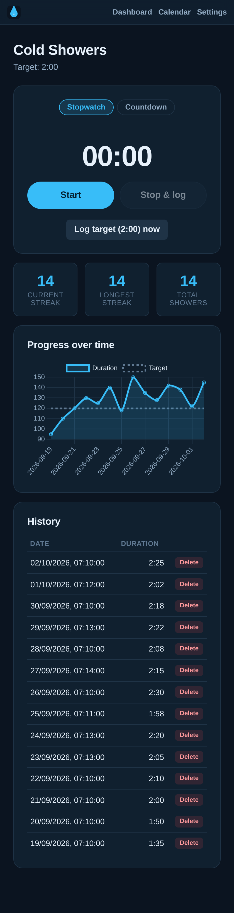
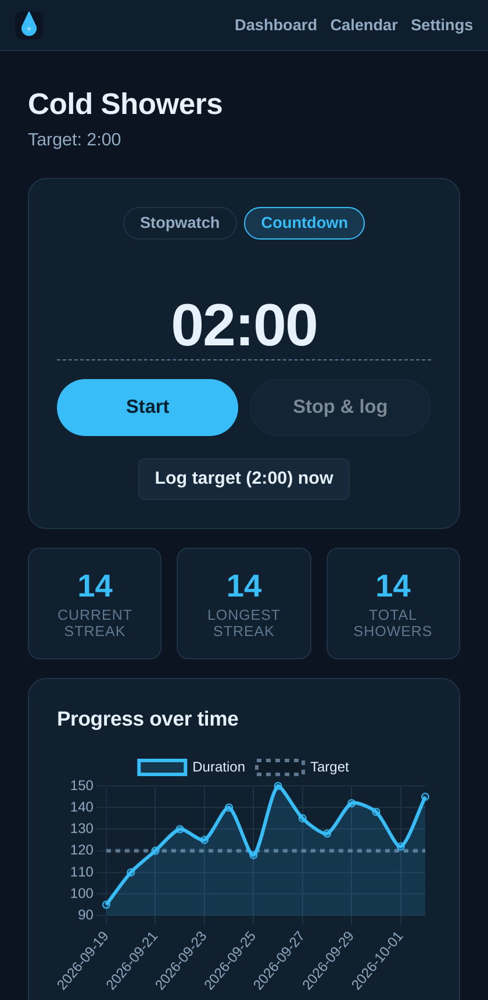
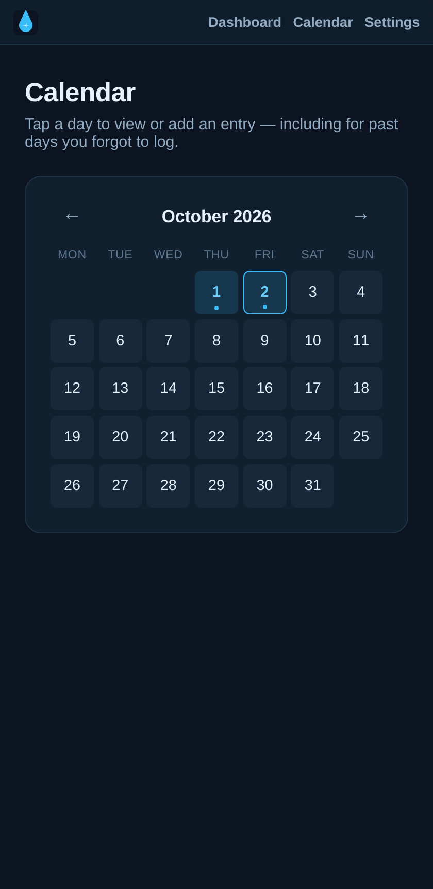
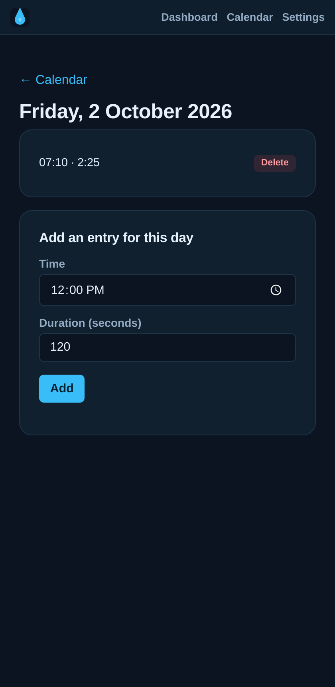
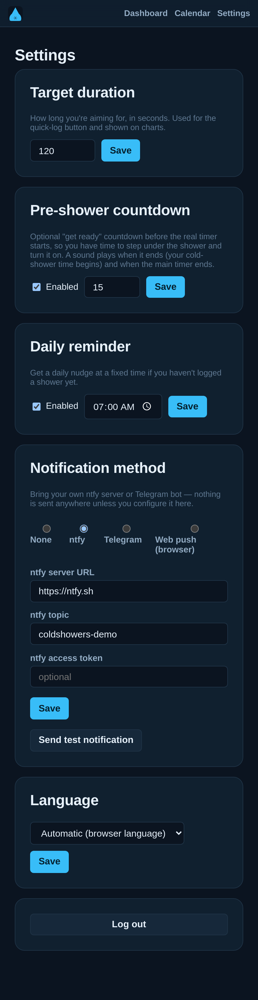
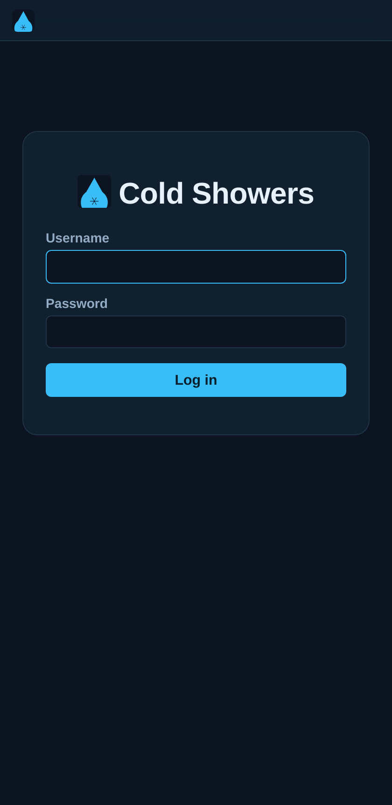

# Cold Showers

A small self-hosted tracker for cold showers: a timer (with an optional pre-shower "get ready" countdown), streaks, a progress chart, a calendar for logging retroactively, and an optional reminder.



## Features

- **Timer**: stopwatch or countdown mode (tap the countdown display to adjust it on the fly), start/stop to log the actual duration, or a one-tap "log target duration now" button. The last-used mode is remembered per device.
- **Optional pre-shower countdown**: a configurable "get ready" countdown before the real timer starts, so you have time to step under the shower and turn it on. A clear alarm sound plays at the handoff into cold-shower time, and again when the timer ends.
- **Configurable target**: default 2 minutes, adjustable in Settings.
- **Streaks and chart**: current/longest streak, total count, and a duration-over-time chart (Chart.js).
- **Calendar view**: see which days you logged a shower, and add entries retroactively for days you forgot.
- **Configurable reminder**: a daily nudge at a time you choose.
- **Bring-your-own notifications**: the reminder can be sent via [ntfy](https://ntfy.sh) (your own server/topic), your own Telegram bot, or browser web push — nothing is hardcoded to any specific deployment, so plug in your own credentials.
- **Installable PWA**: add it to your home screen for an app-like experience, with offline-ready app shell assets.
- **Login**: single-user, session-based (cookie), first launch walks you through creating the one account. Optional single sign-on via any OpenID Connect provider.
- **English and Dutch** UI (English by default).

<details>
<summary>More screenshots</summary>

| Countdown mode | Calendar | Log a past session |
|---|---|---|
|  |  |  |

| Settings | Login |
|---|---|
|  |  |

</details>

## Running it

A ready-made image is published to GHCR on every release — no need to clone and build:

```yaml
# compose.yaml
services:
  app:
    image: ghcr.io/asturale/coldshowers:latest
    restart: unless-stopped
    ports:
      - "127.0.0.1:3000:3000"   # put a reverse proxy with HTTPS in front
    environment:
      - SESSION_SECRET=change-me-to-a-long-random-string
    volumes:
      - ./data:/data
```

```sh
docker compose up -d
```

Prefer building from source instead? Clone this repo and run `docker compose up -d --build` (the included `compose.yaml` does exactly that).

The app listens on port 3000 inside the container. Data is stored as SQLite under `./data` — back that directory up however you already back up the rest of your Docker volumes.

Put this behind your own reverse proxy (Caddy, nginx, Traefik, ...) for TLS. Session cookies are `Secure` by default and won't be set over plain HTTP; for a trusted LAN without HTTPS set `COOKIE_SECURE=false`.

First run: open the site and you'll land on `/setup`. It asks for a one-time setup code, printed in the server log at startup (`docker compose logs | grep 'Setup code'`), so nobody else can claim a fresh instance before you do.

### Environment variables

| Variable | Default | Purpose |
|---|---|---|
| `DATABASE_PATH` | `/data/coldshowers.db` | SQLite file location |
| `COOKIE_SECURE` | `true` | `false` only for plain-HTTP access on a trusted LAN |
| `SESSION_SECRET` | random on each restart if unset | set this to a fixed value so logins survive a container restart |
| `PORT` | `3000` | HTTP port |
| `VAPID_PUBLIC_KEY` / `VAPID_PRIVATE_KEY` | unset | enables the "Web push" reminder method; generate your own with `npx web-push generate-vapid-keys` |
| `VAPID_SUBJECT` | unset | a `mailto:` address required by the push protocol, used only to identify your deployment to push services |
| `OIDC_ISSUER`, `OIDC_CLIENT_ID`, `OIDC_CLIENT_SECRET`, `OIDC_REDIRECT_URI` | unset | enable "Sign in with SSO", see below |

## Sign in with SSO (OpenID Connect)

Optional. Works with any OpenID Connect provider (Authelia, Authentik, Keycloak, Pocket ID, Tinyauth, ...).
Register Cold Showers at your provider as a confidential client with redirect URI
`https://<your-host>/auth/oidc/callback`, then set:

| Variable | Description |
|---|---|
| `OIDC_ISSUER` | the provider's issuer URL (its `/.well-known/openid-configuration` must be reachable from the container) |
| `OIDC_CLIENT_ID` / `OIDC_CLIENT_SECRET` | the client credentials from your provider |
| `OIDC_REDIRECT_URI` | `https://<your-host>/auth/oidc/callback`, exactly as registered |
| `OIDC_PROVIDER_NAME` | button label, e.g. `Authelia` (default `SSO`) |
| `OIDC_SCOPE` | default `openid profile email` |
| `PASSWORD_LOGIN` | `false` = SSO only: the login page goes straight to your provider and password sign-in is refused. Only takes effect when SSO is configured and an account is linked (or `OIDC_LINK_BY_USERNAME=true`), so you can't lock yourself out by setting it too early |
| `OIDC_LINK_BY_USERNAME` | `true` = the first SSO sign-in links to the existing account with the same username. Only for providers where users can't pick or change their own username. Default off |
| `OIDC_USERNAME_CLAIM` | claim used for `OIDC_LINK_BY_USERNAME` (default `preferred_username`) |

SSO never creates accounts. Link your existing account once: sign in with your password, go to
**Settings → Single sign-on → Link**, and confirm at your provider. The link is stored as issuer +
subject, so renaming yourself at the provider doesn't matter.
Reminders keep working with SSO and `PASSWORD_LOGIN=false`.

## Notifications

Configure the reminder method per-user in Settings, not via environment variables (except web push's VAPID keypair, which is deployment-wide — see above) — each user brings their own:

- **ntfy**: server URL (defaults to the public `https://ntfy.sh`), topic name, and an optional access token.
- **Telegram**: your own bot token (create one via [@BotFather](https://t.me/BotFather)) and your chat ID.
- **Web push**: once the server has a VAPID keypair configured, enable push notifications per-browser/device from Settings — no extra credentials needed from the user.

## Tech stack

Express, EJS, better-sqlite3, express-session with a SQLite-backed store — no build step, no external services required beyond whatever notification channel you choose to configure.

## Security

- Secure by default: setup needs a one-time code from the log, cookies are `Secure`, `HttpOnly` and `SameSite=Lax`, sessions expire after 90 days without a visit and get a new ID at every sign-in.
- Failed sign-ins: at most 10 per IP and 50 in total per 15 minutes (in memory, resets on restart). The client IP comes from `X-Forwarded-For` (one trusted hop), so keep the app port reachable only through your proxy.
- Security headers: `nosniff`, `X-Frame-Options: DENY`, `Referrer-Policy` and a CSP that blocks framing, plugins and foreign form targets. **Accepted risk:** the CSP does not yet restrict scripts, because some pages still use inline scripts.
- Still meant for a private network or behind SSO; not hardened for direct public exposure.
